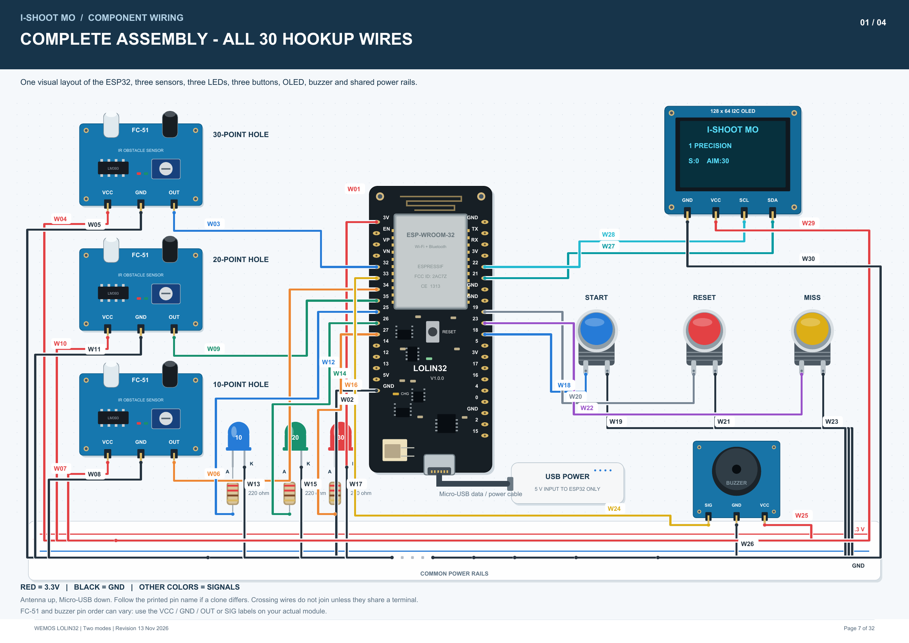

# I-Shoot Mo

ESP32 beanbag toss project for the IoT and Intelligent Systems subjects.

## Current hardware game

- Board: WEMOS LOLIN32 / ESP32.
- Display: confirmed SH1106, 128 x 64 I2C, SDA GPIO21 / SCL GPIO22.
- Buzzer: confirmed active LOW on GPIO33; HIGH is silent.
- Precision: six attempts, two target opportunities per hole, maximum 120.
- Target Chase: 60 seconds, balanced groups of targets and a repeatable
  sequence for fair competition.

Open `creation/code/ishootmo_code/ishootmo_code.ino` in Arduino IDE. Install
the ESP32 board package, Adafruit GFX Library and Adafruit SH110X, accepting
their dependencies. Select WEMOS LOLIN32 and your board's port.

The current saved sketch includes startup, button, mode-selection, scoring
and final ten-second countdown sounds. The later three-beep MISS/wrong-hole
revision was supplied in chat and is not yet present in these saved game
sketches. This repository update preserves the saved `.ino` files as-is.

## Wiring

| Component | GPIO |
| --- | --- |
| 10 / 20 / 30-point sensor OUT | 34 / 35 / 32 |
| Blue 10 / green 20 / red 30-point LED | 25 / 26 / 27 |
| START/MODE / RESET / MISS button | 18 / 19 / 23 |
| Active LOW buzzer I/O | 33 |
| OLED SDA / SCL | 21 / 22 |

Each LED uses its own 220-ohm series resistor. Buttons connect their GPIO
to GND and use internal pull-ups. Use the actual modules' printed pin
labels; pin order can differ from the illustrations.

Detailed diagrams are in `creation/wiring`. The build guide is
`creation/I-Shoot-Mo_ESP32_Complete-Build-Guide.pdf`. The PDF's embedded code,
transfer archives, extracted package and backups preserve earlier versions;
use the current source sketch for the confirmed display and buzzer settings.

## Tests and project records

- `tests/hardware/README.md`: individual board, button, LED, IR, buzzer and
  OLED diagnostic sketches and a manual results checklist.
- `tests/firmware/contract_checks/`: compile-time game, countdown and sound
  queue checks. Hardware testing is still required.
- `creation/code/MAIN SKETCH/`: separately saved main sketch copy.
- `creation/tools/`: PDF and wiring illustration generation tools.
- `creation/backups/`: earlier versions.
- `MISS MIKAY - IOT - INTELLEGENT SYSTEM PROGRESS REPORT/`: progress report.
- `PROPOSAL-tu/` and `MODULES/`: proposals and course reference material.

## Intelligent web application

The agreed three intelligent features are:

1. Adaptive practice difficulty using fuzzy logic, with competition rules
   and target sequences kept fixed for fair comparisons.
2. A personalized player coach using target-specific performance and an
   explainable rule-based expert system.
3. A sensor health monitor using raw sensor states and timing to flag
   possible obstructions, sensitivity problems or inconsistent readings.

The application source is in [web-app](web-app/README.md). The local demo
uses a simulated board for testing. The hosted configuration uses Vercel
and Supabase and connects to the ESP32 over Wi-Fi. The board sends the
aimed target, outcome, and elapsed time for each throw, plus sensor
timing for the board check. The intelligent features apply fuzzy logic
and rules to this data.
